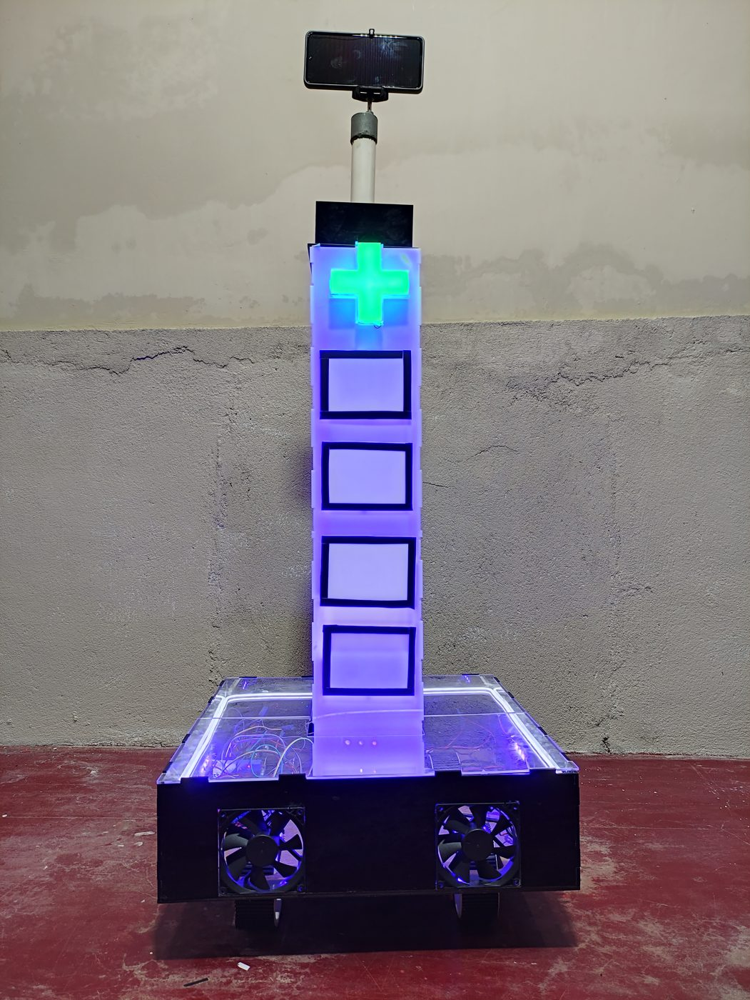
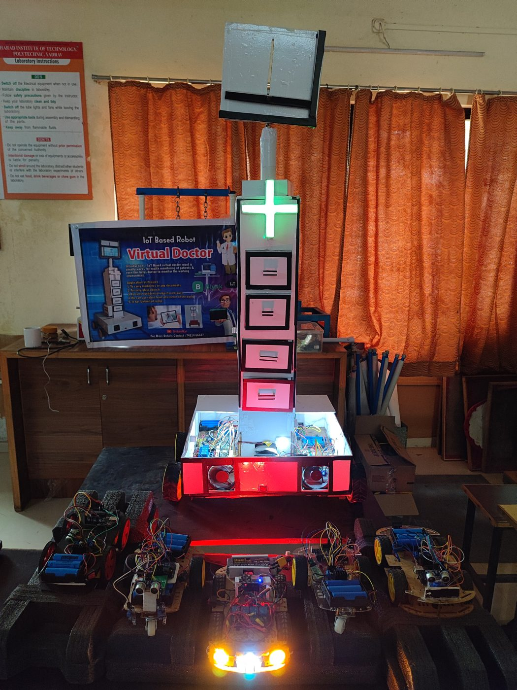
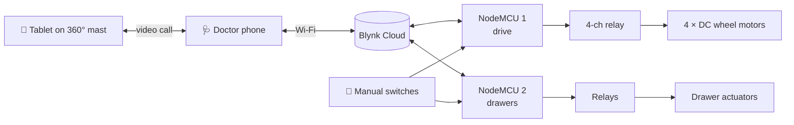
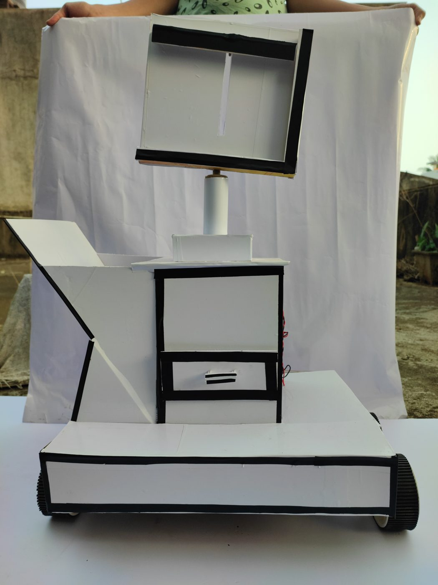
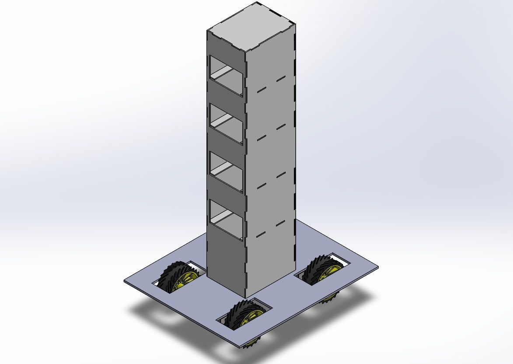
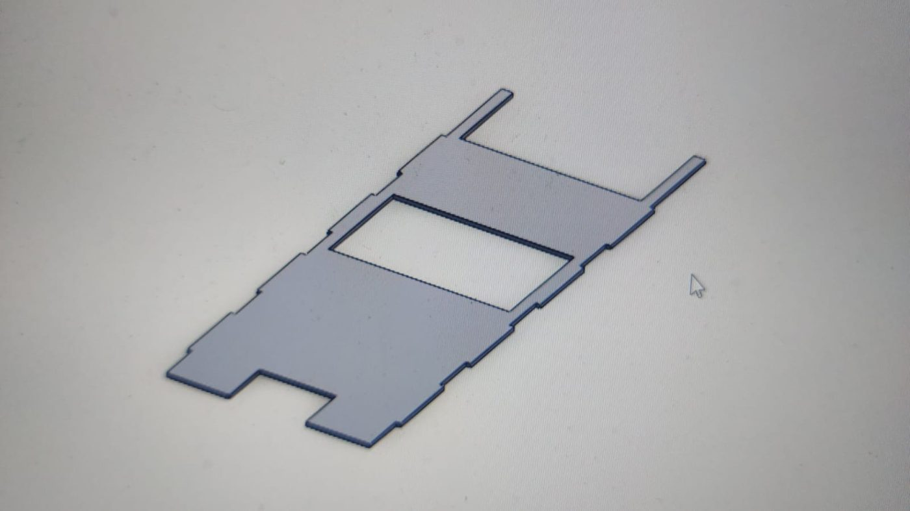
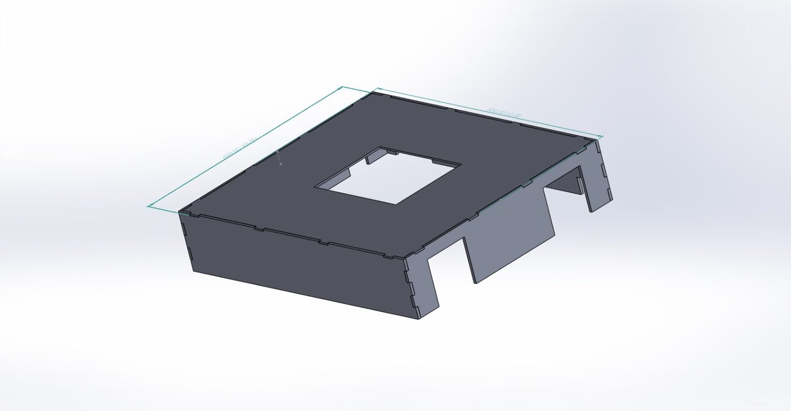
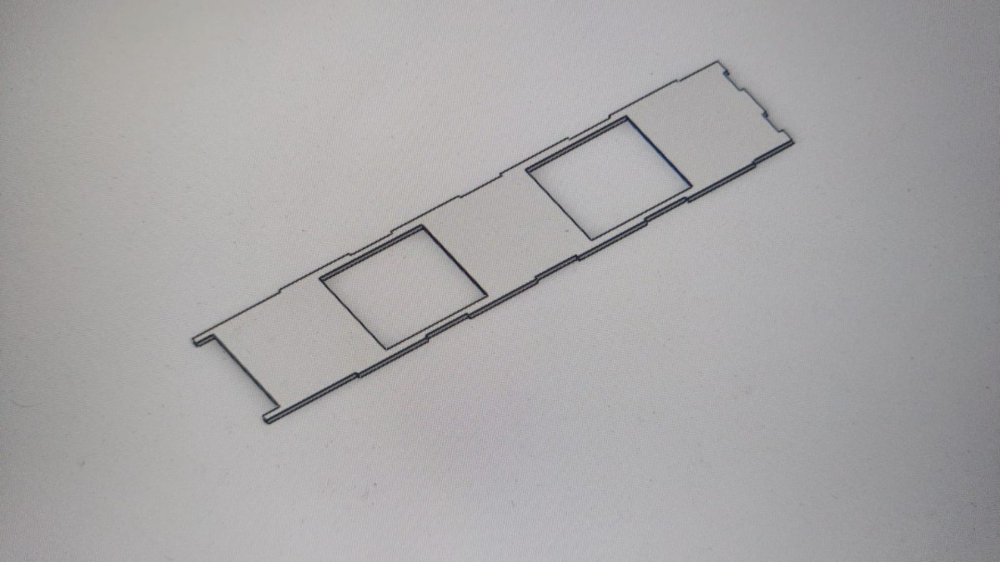

<div align="center">


### 🩺 The doctor stays safe. The patient still gets seen — and gets their medicine.


</div>

---

## 📌 At a glance

> During COVID-19, every bedside visit put doctors at risk. The **Virtual Doctor Robot** goes in their place: it **drives to the patient**, opens a **drawer with the right medicine**, and carries a **tablet on a rotating mast** so doctor and patient can talk face to face over a video call — all controlled from a phone.

<div align="center">
<table>
<tr>
<td align="center" width="50%"><br/><sub><b>The finished robot</b></sub></td>
<td align="center" width="50%"><br/><sub><b>On display at a project exhibition</b></sub></td>
</tr>
</table>
</div>

| 🗓️ Built | 👥 Team | 🧠 My role | 🏆 Result |
|:---:|:---:|:---:|:---:|
| 2021 – 2022 | 4 students | **Team lead** | 1st Prize, Pioneer National-Level Technical Event |

---

## 📑 Contents

- [The problem](#-the-problem)
- [What it does](#-what-it-does)
- [How it works](#-how-it-works)
- [From sketch to robot](#-from-sketch-to-robot)
- [Hardware](#-hardware)
- [Code](#-code)
- [Repository map](#-repository-map)
- [What I learned](#-what-i-learned)

---

## 🎯 The problem

In isolation wards, every visit means protective gear, exposure risk and time. Patients still need to see a doctor and receive medicine on schedule.

**Goal:** a low-cost robot that lets a doctor **see, talk to and hand medicine to** a patient without entering the room.

---

## ✨ What it does

<table>
<tr>
<td width="33%" align="center" valign="top">

### 🚗 Drives to the bed
A **four-wheel mobile base** steered remotely from the phone.

</td>
<td width="33%" align="center" valign="top">

### 💊 Delivers medicine
**Actuator-controlled drawers** open one at a time — contactless hand-over.

</td>
<td width="33%" align="center" valign="top">

### 📹 Video consultation
A tablet on a **360° rotating mast** carries a live doctor–patient video call.

</td>
</tr>
<tr>
<td width="33%" align="center" valign="top">

### 📱 One app
Driving and the drawers run from a **Blynk dashboard**.

</td>
<td width="33%" align="center" valign="top">

### 🔘 Works offline too
Physical switches still control every relay if Wi-Fi drops.

</td>
<td width="33%" align="center" valign="top">

### 💡 Easy to spot
Illuminated base and a glowing green cross on the mast.

</td>
</tr>
</table>

---

## 🔄 How it works



Each NodeMCU keeps the app and the relays **in sync**: it checks the Blynk connection every 3 seconds, pushes the real relay states back to the app, and shows Wi-Fi status on an LED. If the connection is lost, the manual switches keep working.

---

## 🛠️ From sketch to robot

<table>
<tr>
<td width="25%" align="center"><br/><b>① Mock-up</b><br/><sub>Full-size foam-board model to test proportions</sub></td>
<td width="25%" align="center"><br/><b>② CAD</b><br/><sub>Drawer tower and base modelled in SolidWorks</sub></td>
<td width="25%" align="center"><br/><b>③ Laser-cut parts</b><br/><sub>Every panel exported as DXF</sub></td>
<td width="25%" align="center"><br/><b>④ Finished robot</b><br/><sub>Assembled, wired and lit</sub></td>
</tr>
</table>

<details>
<summary><b>▶ More CAD views</b></summary>

<table>
<tr>
<td width="50%"></td>
<td width="50%"></td>
</tr>
</table>

</details>

**Body parts in [`dxf Files/`](dxf%20Files):** base panels · drawer fronts, sides and supports · tripod mast stand · the green cross · front and rear body panels.

---

## 🔌 Hardware

| Subsystem | Components |
|---|---|
| 🧠 **Controllers** | NodeMCU (ESP8266) boards · Arduino |
| ⚡ **Switching** | 4- and 8-channel relay modules · manual override switches |
| 🏎️ **Drive** | 4 × DC geared motors, relay-switched |
| 💊 **Drawers** | Actuator-driven medicine drawers |
| 📹 **Telepresence** | Tablet on a 360° rotating mast |
| 💡 **Lighting** | LED-lit base and cross |
| 🏗️ **Body** | Laser-cut panels from DXF drawings |

---

## 💻 Code

| File | Runs on | Does |
|---|---|---|
| [`4_MOTORS_BY_RELAY.ino`](4_MOTORS_BY_RELAY.ino) | NodeMCU | Four relays for the wheel motors (`V9`–`V12`) |
| [`8 relay.ino`](8%20relay.ino) | NodeMCU | Four relays (`V5`–`V8`) for the drawers, with manual-switch fallback |

```cpp
void checkBlynkStatus() {              // every 3 s
  if (Blynk.connected()) {
    Blynk.virtualWrite(VPIN_BUTTON_1, toggleState_1);   // keep app in sync
  }
}

BLYNK_WRITE(VPIN_BUTTON_1) {           // app button → relay
  toggleState_1 = param.asInt();
  digitalWrite(RelayPin1, toggleState_1);
}
```

<details>
<summary><b>▶ How to run it</b></summary>

1. Install the **ESP8266 board package** and the **Blynk** library in the Arduino IDE
2. Enter **your own** Blynk auth token and Wi-Fi name/password in each sketch
3. Upload one sketch to each NodeMCU and wire the relays as defined at the top of the file
4. Add buttons on the matching virtual pins in the Blynk app

</details>

---

## 🗂️ Repository map

```
📦 Virtual-Doctor-Robot-
 ┣ 📜 4_MOTORS_BY_RELAY.ino   ← wheel motors via relays
 ┣ 📜 8 relay.ino             ← drawer relays, manual-switch fallback
 ┣ 📂 dxf Files               ← laser-cut body, drawers, mast and cross
 ┣ 📂 media                   ← photos and CAD views used in this README
 ┗ 📘 README.md
```

---

## 🧠 What I learned

- 🩺 **Designing for a real problem** under real constraints — a pandemic, a student budget and a deadline
- 🧱 **Prototype first** — a foam-board mock-up saved us from cutting the wrong parts
- 📐 **CAD to laser cutter** — a full body from DXF drawings
- 👥 **Leading a team of four** to a national first prize

---

<div align="center">

### 👋 Built by **Ajay Arjun Mannolkar**
M.Sc. Mechatronics & Cyber-Physical Systems · THD Deggendorf

[](https://technolkar.github.io)
[](https://www.linkedin.com/in/ajaymannolkar)
[](https://www.youtube.com/@TechnolkarInnovations)

⭐ *If this project inspired you, give it a star!*


</div>
